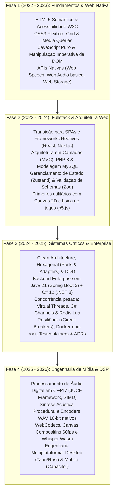

# 📚 Learning Hub — Engineering Archive & Second Brain

> **Arquivo histórico de formação técnica, caderno de notas de engenharia e laboratório de fundamentos** mantido por [Felipe Gardenghi](https://felipegardenghi.com.br). Reúne exercícios de base, protótipos de cursos, projetos acadêmicos e retrospectivas arquiteturais sob a ótica da engenharia de software sênior.

[](https://felipegardenghidev.github.io/learning-hub/)
[](https://github.com/FelipeGardenghiDev/projeto-homestudio)
[](LICENSE)
[](#)

> [!NOTE]
> **Aviso de Escopo & Contexto:**  
> Este repositório é um **Arquivo Histórico e Caderno de Estudos (Second Brain)**, e **não** uma vitrine de produtos acabados. O código das subpastas reflete fielmente o nível de conhecimento da época em que cada exercício foi feito (2022 a 2024).  
> Para avaliar arquiteturas corporativas e sistemas modernos em produção, consulte os repositórios da **[Suíte Garden](https://github.com/FelipeGardenghiDev/garden-cut)**, a **[Fraud Detection API](https://github.com/FelipeGardenghiDev/fraud-detection-api)** (Java 21) e a **[Order Processing API](https://github.com/FelipeGardenghiDev/order-processing-api)** (.NET 8).

---

## 🎯 Princípios Deste Repositório

1. **Preservação Histórica com Honestidade Técnica:** Nenhum código do passado foi maquiado. O valor está em registrar como os fundamentos foram absorvidos e consolidados sem atalhos.
2. **Rastreabilidade Evolutiva (Da Semente à Produção):** Cada estudo didático do passado é mapeado diretamente para o sistema de alta complexidade em que ele desaguou no presente.
3. **Modelos Mentais & Cheat Sheets:** Centraliza guias de consulta rápida sobre conceitos de computação de baixo nível (Event Loop, Arquitetura Hexagonal, CSS Layout Engine).

---

## 📈 Linha Evolutiva de Maestria (2022 ➔ 2026)



---

## 🧭 Tech Radar Pessoal (Status Atual de Engenharia)

| Status | Tecnologias & Paradigmas | Justificativa Arquitetural |
| :--- | :--- | :--- |
| **ADOTAR (Core Diário)** | TypeScript 5.8+, React 19, Java 21 (Spring 3), C# 12 (.NET 8), C++17 JUCE, Web Audio API, Docker, Vitest | Pilares de produção usados para construir a suíte criativa [Garden Apps](https://github.com/FelipeGardenghiDev/garden-cut) e APIs financeiras críticas. |
| **FUNDAMENTOS CONSOLIDADOS** | HTML5/CSS3, DOM Nativo, PHP/MySQL, Next.js App Router, Tailwind v4, Zod, Redis Lua | Conhecimento consolidado nos projetos deste repositório, servindo de base para decisões de baixo nível. |
| **AVALIANDO / PESQUISA** | WebGPU Shaders, Rust para WebAssembly DSP, AudioWorklet com SharedArrayBuffer, ONNX Runtime Web | Tecnologias em estudo ativo para a próxima geração de ferramentas de áudio e inteligência artificial no browser. |

---

## 📖 Modelos Mentais & Cheat Sheets Rápidos

Guias de referência rápida mantidos na pasta [`docs/cheatsheets/`](./docs/cheatsheets/):

* ⚡ **[Event Loop, Microtasks & Concorrência no Navegador](./docs/cheatsheets/event-loop-e-concorrencia.md):** Call Stack, prioridade de drenagem de Microtasks (Promises), sincronização com vsync (`requestAnimationFrame`) e isolamento da thread de áudio de tempo real.
* 🏛️ **[Arquitetura Hexagonal (Ports & Adapters) & DDD](./docs/cheatsheets/arquitetura-hexagonal-e-ddd.md):** Regra de Dependência, isolamento do Domínio puro de frameworks e infraestrutura, inversores de controle.
* 📐 **[Árvore de Decisão: Flexbox 1D vs. CSS Grid 2D](./docs/cheatsheets/css-layout-decision-tree.md):** Fluxos intrínsecos de conteúdo vs matrizes estruturais rígidas de layout.

---

## 🗂️ Arquivo de Estudos & Rastreabilidade para a Produção

### ⚡ JavaScript & APIs Web

| Estudo Histórico | Ano | Conceitos Trabalhados | 💡 Retrospectiva Sênior | 🌱 Semente de Produção (Onde Desaguou) |
| :--- | :---: | :--- | :--- | :--- |
| **[`fokus`](./alura-javascript/fokus/)** | 2022 | Timer Pomodoro e primeiros disparos de áudio via web. | A mutação de classes CSS acoplava a lógica ao DOM. Em produção, timers devem ser FSMs puras desacopladas. | ➔ **[garden-sfx-lab](https://github.com/FelipeGardenghiDev/garden-sfx-lab)** (Síntese DSP) e **[underground-tools](https://github.com/FelipeGardenghiDev/underground-tools)** |
| **[`monibank`](./alura-javascript/monibank/)** | 2022 | Validação de formulários no cliente e algoritmo de CPF. | Validações manuais são frágeis. Em produção, contratos são garantidos por schemas declarativos Zod/FluentValidation. | ➔ **[fraud-detection-api](https://github.com/FelipeGardenghiDev/fraud-detection-api)** e **[order-processing-api](https://github.com/FelipeGardenghiDev/order-processing-api)** |
| **[`alugames`](./alura-javascript/alugames/)** | 2022 | Gerenciamento de status e alternância de classes DOM. | O controle por classes gera dependência frágil do CSS. Utilizaria Signals ou Redux modelando eventos de domínio. | ➔ **[garden-streamdeck](https://github.com/FelipeGardenghiDev/garden-streamdeck)** (FSM de Botões OBS) |
| **[`jogo-numero-secreto`](./alura-javascript/jogo-numero-secreto/)** | 2023 | Interação por voz utilizando a Web Speech API. | Dependência de Speech API exclui navegadores sem suporte. Arquiteturas resilientes exigem fallbacks locais. | ➔ **[garden-subtitle](https://github.com/FelipeGardenghiDev/garden-subtitle)** (Whisper Wasm Local) |
| **[`lista-de-compras`](./alura-javascript/lista-de-compras/)** | 2022 | Persistência de dados em `localStorage`. | `localStorage` executa I/O síncrono bloqueante. Para dados ricos, adota-se IndexedDB assíncrono com transações. | ➔ **[garden-pixel-editor](https://github.com/FelipeGardenghiDev/garden-pixel-editor)** (IndexedDB Engine) |

---

### 🌐 Fundamentos Web & Layout Responsivo

| Estudo Histórico | Ano | Conceitos Trabalhados | 💡 Retrospectiva Sênior | 🌱 Semente de Produção (Onde Desaguou) |
| :--- | :---: | :--- | :--- | :--- |
| **[`aluraplus`](./alura-fundamentos-web/aluraplus/)** | 2022 | Landing page de streaming com CSS Flexbox. | Estruturas clássicas se beneficiam de Design Tokens e tags `<picture>` com WebP/AVIF para economia de banda. | ➔ **[revanche-website](https://github.com/FelipeGardenghiDev/revanche-website)** e **[portfolio](https://felipegardenghi.com.br)** |
| **[`meteora-vestimentas`](./alura-fundamentos-web/meteora-vestimentas/)** | 2022 | E-commerce com Bootstrap 5 e componentes prontos. | O Bootstrap introduz peso de CSS desnecessário. Priorizo Tailwind CSS compilado via Vite (< 20KB). | ➔ **[saas-agency-boilerplate](https://github.com/FelipeGardenghiDev/saas-agency-boilerplate)** e **[finrisk-operations-hub](https://github.com/FelipeGardenghiDev/finrisk-operations-hub)** |
| **[`serenatto-cafe`](./alura-fundamentos-web/serenatto-cafe/)** | 2022 | Website de cafeteria com CSS Grid. | Sites institucionais exigem SSG (Next.js/Astro) e schema `LocalBusiness` em JSON-LD para indexação Google. | ➔ **[pauta-limpa](https://github.com/FelipeGardenghiDev/pauta-limpa)** e **[agrofinance-dashboard](https://github.com/FelipeGardenghiDev/agrofinance-dashboard)** |

---

### 🧪 Mini-Projetos, Jogos & Experimentos

| Estudo Histórico | Ano | Conceitos Trabalhados | 💡 Retrospectiva Sênior | 🌱 Semente de Produção (Onde Desaguou) |
| :--- | :---: | :--- | :--- | :--- |
| **[`pong-copilot`](./mini-projetos/pong-copilot/)** | 2023 | Releitura de Pong com física vetorial no Canvas 2D. | Em jogos no browser, a física deve usar *Fixed Timestep Loop* para não descompassar em telas de 120Hz/144Hz. | ➔ **[garden-auto-framer](https://github.com/FelipeGardenghiDev/garden-auto-framer)** e **[garden-cut](https://github.com/FelipeGardenghiDev/garden-cut)** (Canvas Engine) |
| **[`code-connect`](./mini-projetos/code-connect/)** | 2023 | Feed social para compartilhamento de snippets. | Feito com cards estáticos no DOM. Feeds reais requerem virtualização de lista (*windowing*) para manter o DOM leve. | ➔ **[Discord-like](https://github.com/FelipeGardenghiDev/Discord-like)** (Hexagonal & WebSockets) |
| **[`aggrandize-planner`](./mini-projetos/aggrandize-planner/)** | 2024 | SaaS de planejamento com Next.js 14, Zustand e Zod. | Marcou a transição para a Fase 2 (Fullstack). Adicionaria testes E2E com Playwright para fluxo de login simulado. | ➔ **[ops-room](https://github.com/FelipeGardenghiDev/ops-room)** e **[software-house-ops](https://github.com/FelipeGardenghiDev/software-house-ops)** |
| **[`organize`](./mini-projetos/organize/)** | 2023 | Sistema financeiro em PHP e banco relacional. | Monólito em PHP clássico. Consolidou modelagem de banco. Hoje seria decomposto em API REST/gRPC desacoplada. | ➔ **[order-processing-api](https://github.com/FelipeGardenghiDev/order-processing-api)** (Clean Arch C#) |
| **[`revanche-website-legado`](./mini-projetos/revanche-website-legado/)** | 2023 | Versão v1 estática do site da Banda Revanche. | Serviu como base visual e teste de layout antes da reescrita oficial moderna no repositório de produção. | ➔ **[revanche-website](https://github.com/FelipeGardenghiDev/revanche-website)** (Next.js 16 + React 19) |

---

### 🎓 Projetos Acadêmicos & Integradores

| Estudo Histórico | Ano | Conceitos Trabalhados | 💡 Retrospectiva Sênior | 🌱 Semente de Produção (Onde Desaguou) |
| :--- | :---: | :--- | :--- | :--- |
| **[`flora-acessorios-pi3`](./projetos-academicos/flora-acessorios-pi3/)** | 2023 | Projeto Integrador UNIVESP (PJI310) em 3 camadas. | Sistema acadêmico em 3 camadas com MySQL. Na evolução posterior (PI4), evoluiu para modelo preditivo de ML. | ➔ **[flora-acessorios-pi4](https://github.com/FelipeGardenghiDev/flora-acessorios-pi4)** (ML Neural Net + React) |

---

## 🛠️ Como Navegar Localmente

Para abrir o portal de consulta localmente:

```powershell
npm run serve
# Abre em http://localhost:3000
```

---

## 🌿 Ecossistema GC Studio

Este repositório é a raiz histórica do estúdio mantido por **Felipe Gardenghi**.  
Para conhecer os projetos avançados em produção desenvolvidos a partir dessa base:

* 🎬 **[GardenCut](https://github.com/FelipeGardenghiDev/garden-cut):** Editor de vídeo não-linear web & mobile (Staff-level).
* 🛡️ **[Fraud Detection API](https://github.com/FelipeGardenghiDev/fraud-detection-api)**: Microsserviço bancário com Hexagonal Arch, Redis Lua e Virtual Threads.
* 📦 **[Order Processing API](https://github.com/FelipeGardenghiDev/order-processing-api)**: Engine de alta concorrência em C# .NET 8 com Clean Architecture e Channels.
* 🎛️ **[Underground Tools](https://github.com/FelipeGardenghiDev/underground-tools)**: Plugins de áudio VST3/AU profissionais em C++17 JUCE com zero-alloc.
* 🌐 **[Portfólio Oficial](https://felipegardenghi.com.br)**: Hub com biografia técnica e projetos em produção.

---

## 📄 Licença
Distribuído sob a licença MIT. Criado e mantido por Felipe Gardenghi.
