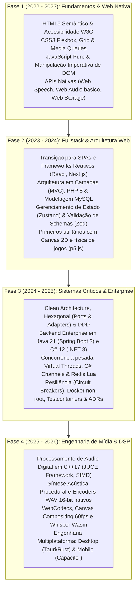

# 📚 Learning Hub — Engineering Knowledge Log & Fundamentos

> **Repositório vivo de formação contínua, diário de bordo técnico e laboratório prático** mantido por [Felipe Gardenghi](https://felipegardenghi.com.br). Reúne exercícios fundamentais, protótipos de cursos, projetos acadêmicos e retrospectivas arquiteturais sob a ótica da engenharia de software sênior.

[](https://felipegardenghidev.github.io/learning-hub/)
[](https://github.com/FelipeGardenghiDev/projeto-homestudio)
[](LICENSE)
[](#)

---

## 🎯 Por que este repositório existe?

Todo engenheiro sênior constrói sua bagagem a partir de um alicerce sólido de fundamentos. Em vez de descartar códigos antigos ou fragmentá-los em dezenas de micro-repositórios abandonados, o **Learning Hub** adota a filosofia de **Digital Garden & Knowledge Architecture**:
1. **Preserva a história e honestidade técnica:** Os códigos das subpastas mantêm sua forma histórica original, demonstrando o ponto de partida e o ritmo de absorção de novos paradigmas.
2. **Adiciona maturidade crítica:** Cada projeto possui uma **Retrospectiva Sênior**, documentando trade-offs, armadilhas identificadas e como aquele problema seria resolvido hoje em arquiteturas de produção.
3. **Showcase interativo em 1 clique:** Inclui um portal unificado ([`index.html`](./index.html)) pronto para rodar localmente ou no GitHub Pages, permitindo testar as aplicações diretamente pelo navegador sem configurar servidores.

---

## 📈 Linha Evolutiva de Maestria (2022 ➔ 2026)



---

## 🧭 Tech Radar Pessoal (Status Atual de Engenharia)

| Status | Tecnologias & Paradigmas | Justificativa Arquitetural |
| :--- | :--- | :--- |
| **ADOTAR (Core Diário)** | TypeScript 5.8+, React 19, Java 21 (Spring 3), C# 12 (.NET 8), C++17 JUCE, Web Audio API, Docker, Vitest | Pilares de produção usados para construir a suíte criativa [Garden Apps](https://github.com/FelipeGardenghiDev/garden-cut) e APIs financeiras críticas. |
| **FUNDAMENTOS CONSOLIDADOS** | HTML5/CSS3, DOM Nativo, PHP/MySQL, Next.js App Router, Tailwind v4, Zod, Redis Lua | Conhecimento consolidado nos projetos deste repositório, servindo de base para decisões de baixo nível. |
| **AVALIANDO / PESQUISA** | WebGPU Shaders, Rust para WebAssembly DSP, AudioWorklet com SharedArrayBuffer, ONNX Runtime Web | Tecnologias em estudo ativo para a próxima geração de ferramentas de áudio e inteligência artificial no browser. |

---

## 🗂️ Catálogo de Projetos & Retrospectivas Técnicas

### ⚡ JavaScript & APIs Web do Navegador

| Projeto | Stack Histórica | Conceitos Trabalhados | 💡 Retrospectiva Sênior (O que faria hoje) | Acesso |
| :--- | :--- | :--- | :--- | :---: |
| **[`fokus`](./alura-javascript/fokus/)** | JS Puro, Web Audio API, CSS3 | Timer Pomodoro com contagem regressiva, seleção de intervalos e efeitos sonoros. | **Isolamento de Estado:** A mutação direta de classes CSS acoplou a lógica ao DOM. Hoje, o timer seria uma Máquina de Estados Finitos (FSM) pura, testável sem browser, e os sons sintetizados proceduralmente. | [Demo](./alura-javascript/fokus/index.html) |
| **[`gardenbank`](./alura-javascript/gardenbank/)** | JS Puro, Regex, Form API | Validação de formulários no cliente, algoritmo verificador de CPF e cálculo de maioridade. | **Type-Safe Validation:** Em vez de manipulação manual de `customValidity`, utilizaria esquemas declarativos com Zod ou FluentValidation, garantindo contratos unificados entre front e backend. | [Demo](./alura-javascript/gardenbank/index.html) |
| **[`alugames`](./alura-javascript/alugames/)** | JS Puro, DOM | Gerenciamento de empréstimo de board games e alternância de estado de botões. | **Reatividade Desacoplada:** O controle por classes `.dashboard__item__button--devolver` cria dependência frágil do CSS. Utilizaria Signals ou Redux modelando a transição de posse do item como evento de domínio. | [Demo](./alura-javascript/alugames/index.html) |
| **[`jogo-numero-secreto`](./alura-javascript/jogo-numero-secreto/)** | JS, Web Speech API | Reconhecimento de voz para interação em jogo de adivinhação numérica. | **Fallback de Acessibilidade:** A dependência exclusiva de Speech Recognition exclui navegadores sem suporte nativo. Uma arquitetura resiliente incluiria fallback automático para input textual e microfone local. | [Demo](./alura-javascript/jogo-numero-secreto/index.html) |
| **[`lista-de-compras`](./alura-javascript/lista-de-compras/)** | JS, LocalStorage | CRUD de itens de mercado com persistência no navegador. | **Persistência Não-Bloqueante:** O `localStorage` é síncrono e trava a main thread em volumes maiores. Em cenários reais, o padrão adotado é IndexedDB assíncrono com transações atômicas. | [Demo](./alura-javascript/lista-de-compras/index.html) |

---

### 🌐 Fundamentos Web & Layout Responsivo

| Projeto | Stack Histórica | Conceitos Trabalhados | 💡 Retrospectiva Sênior (O que faria hoje) | Acesso |
| :--- | :--- | :--- | :--- | :---: |
| **[`aluraplus`](./alura-fundamentos-web/aluraplus/)** | HTML5, CSS3, Flexbox | Landing page de streaming com hierarquia tipográfica e media queries. | **Mobile-First & Design Tokens:** A estrutura clássica em CSS puro se beneficiaria de Design Tokens (Tailwind v4 / CSS Variables semânticas) e tags `<picture>` com WebP/AVIF para otimização de banda. | [Demo](./alura-fundamentos-web/aluraplus/index.html) |
| **[`meteora-vestimentas`](./alura-fundamentos-web/meteora-vestimentas/)** | HTML5, Bootstrap 5, JS | E-commerce de moda com carrossel, modais e componentes prontos. | **Zero-Dependency Styling:** O Bootstrap introduz peso de folha de estilo desnecessário. Em projetos modernos, priorizo Tailwind CSS compilado via Vite, mantendo o bundle CSS abaixo de 20KB. | [Demo](./alura-fundamentos-web/meteora-vestimentas/index.html) |
| **[`serenatto-cafe`](./alura-fundamentos-web/serenatto-cafe/)** | HTML5, CSS Grid | Website de cafeteria com cardápio gastronômico dinâmico. | **SEO & Server-Side Rendering:** Sendo um site institucional de alimentação, a arquitetura ideal hoje é estática com geração SSG (Next.js/Astro) e schema `LocalBusiness` em JSON-LD para indexação no Google. | [Demo](./alura-fundamentos-web/serenatto-cafe/index.html) |

---

### 🧪 Mini-Projetos, Jogos & Experimentos

| Projeto | Stack Histórica | Conceitos Trabalhados | 💡 Retrospectiva Sênior (O que faria hoje) | Acesso |
| :--- | :--- | :--- | :--- | :---: |
| **[`aggrandize-planner`](./mini-projetos/aggrandize-planner/)** | Next.js 14, Zustand, Zod, Tailwind | SaaS de planejamento de tarefas com métricas e Magic Link simulado. | **Pilar de Transição:** Este projeto marcou a maturidade da Fase 2. A arquitetura já utiliza TypeScript estrito, separação em stores Zustand e validação Zod. Hoje adicionaria testes de integração com Playwright. | [Código](./mini-projetos/aggrandize-planner/) |
| **[`pong-copilot`](./mini-projetos/pong-copilot/)** | JavaScript, p5.js, Canvas 2D | Releitura de Pong com física vetorial e detecção de colisões. | **Fixed Timestep Loop:** Em jogos que utilizam `requestAnimationFrame`, a física deve ser desacoplada da taxa de quadros (*Delta Time com fixed timestep*) para evitar física instável em telas de 120Hz/144Hz. | [Demo](./mini-projetos/pong-copilot/index.html) |
| **[`code-connect`](./mini-projetos/code-connect/)** | HTML5, CSS3, JavaScript | Feed comunitário de desenvolvedores para compartilhamento de snippets. | **Componentização & Virtualização:** Feito com cards estáticos no DOM. Para feeds de dados reais, adota-se virtualização de lista (*windowing*) para manter o DOM leve mesmo com milhares de postagens. | [Demo](./mini-projetos/code-connect/index.html) |
| **[`organize`](./mini-projetos/organize/)** | PHP, SQLite/MySQL, CSS | Sistema de gestão financeira empresarial para pequenos comércios. | **Separação de Camadas:** Monólito em PHP clássico. Serviu para consolidar modelagem relacional. Hoje seria decomposto em API REST/gRPC desacoplada do cliente web. | [Código](./mini-projetos/organize/) |
| **[`revanche-website-legado`](./mini-projetos/revanche-website-legado/)** | HTML5, CSS Glassmorphism, JS | Versão v1 estática do site da Banda Revanche (registro histórico). | **Histórico de Migração:** Serviu como base visual e teste de layout antes da reescrita oficial moderna no repositório [revanche-website](https://github.com/FelipeGardenghiDev/revanche-website) (Next.js 16 + React 19). | [Demo](./mini-projetos/revanche-website-legado/index.html) |

---

### 🎓 Projetos Acadêmicos & Integradores

| Projeto | Stack Histórica | Conceitos Trabalhados | 💡 Retrospectiva Sênior (O que faria hoje) | Acesso |
| :--- | :--- | :--- | :--- | :---: |
| **[`flora-acessorios-pi3`](./projetos-academicos/flora-acessorios-pi3/)** | PHP, MySQL, JavaScript | Projeto Integrador UNIVESP (PJI310). Gestão de pedidos e vendas em 3 camadas. | **Domain-Driven Design (DDD):** Sistema acadêmico em 3 camadas com modelagem relacional completa. Na evolução posterior (PI4), evoluiu para uma aplicação integrada com modelo preditivo de Machine Learning. | [Código](./projetos-academicos/flora-acessorios-pi3/) |

---

## 🧠 Lições de Arquitetura em Profundidade

### 1. Manipulação Imperativa de DOM vs. Reatividade Determinística
* **Abordagem Inicial (2022):** Modificar elementos visuais diretamente com `element.innerHTML`, `classList.add` e `addEventListener` espalhados.
* **Paradigma Sênior:** A interface é uma função pura e reativa do estado:
  $$\text{UI} = f(\text{State})$$
  Toda a regra de negócio vive em entidades puras ou máquinas de estados (FSM). A camada de apresentação apenas reage a eventos e renderiza o estado calculado, permitindo cobertura de 100% de testes unitários sem abrir navegadores.

### 2. LocalStorage vs. IndexedDB & Armazenamento Não-Bloqueante
* **Abordagem Inicial:** `localStorage.setItem('key', JSON.stringify(data))`.
* **Paradigma Sênior:** O `localStorage` executa I/O síncrono bloqueando a thread principal de renderização, além de não suportar índices ou transações. Para produtos complexos (como [Garden Pixel Editor](https://github.com/FelipeGardenghiDev/garden-pixel-editor)), utiliza-se **IndexedDB assíncrono** com versionamento formal de esquema e recuperação automática após crash.

### 3. Síntese Acústica em Tempo Real vs. Ativos Estáticos
* **Abordagem Inicial:** Disparar arquivos `.mp3` ou `.wav` estáticos via `new Audio()`.
* **Paradigma Sênior:** Áudios pré-gravados geram latência de requisição, consomem banda e não permitem modulação em tempo real. A evolução técnica deste aprendizado resultou no [Garden SFX Lab](https://github.com/FelipeGardenghiDev/garden-sfx-lab), onde qualquer efeito retrô (tiro, pulo, explosão) é sintetizado via DSP com osciladores e envelopes matemáticos diretamente na CPU/GPU do cliente.

---

## 🛠️ Developer Experience (DX) & Como Rodar

O repositório foi configurado com scripts centralizados para rodar o portal interativo em um único comando:

```powershell
# 1. Iniciar o Showcase Portal local com todas as demos ativas
npm run serve
# ou: npx serve . -p 3000

# 2. Acessar no navegador
# http://localhost:3000
```

Para rodar projetos específicos que exigem Node.js (como o `aggrandize-planner`):
```powershell
cd mini-projetos/aggrandize-planner
pnpm install
pnpm dev
```

---

## 🌿 Ecossistema GC Studio

Este repositório é a raiz histórica do estúdio mantido por **Felipe Gardenghi**.  
Para conhecer os projetos avançados de produção desenvolvidos a partir dessa base:

* 🎬 **[GardenCut](https://github.com/FelipeGardenghiDev/garden-cut):** Editor de vídeo não-linear web & mobile (Staff-level).
* 🛡️ **[Fraud Detection API](https://github.com/FelipeGardenghiDev/fraud-detection-api)**: Microsserviço bancário com Hexagonal Arch, Redis Lua e Virtual Threads.
* 📦 **[Order Processing API](https://github.com/FelipeGardenghiDev/order-processing-api)**: Engine de alta concorrência em C# .NET 8 com Clean Architecture e Channels.
* 🎛️ **[Underground Tools](https://github.com/FelipeGardenghiDev/underground-tools)**: Plugins de áudio VST3/AU profissionais em C++17 JUCE com zero-alloc.
* 🌐 **[Portfólio Oficial](https://felipegardenghi.com.br)**: Hub com biografia técnica e projetos em produção.

---

## 📄 Licença
Distribuído sob a licença MIT. Criado e mantido por Felipe Gardenghi.
