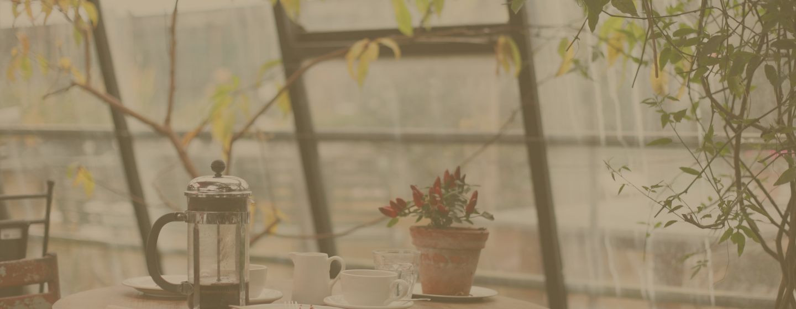

# ☕ Serenatto Café & Bistrô

> Projeto de portfólio front-end inspirado no projeto **Serenatto Café & Bistrô**, desenvolvido durante cursos de desenvolvimento front-end da [Alura](https://www.alura.com.br/).

<p align="center">
  
</p>

<p align="center">
  
  
  
  
</p>

<p align="center">
  <a href="https://felipegardenghidev.github.io/SerenattoCafeBistro/" target="_blank">
    
  </a>
</p>

---

## 📋 Sobre o projeto

O **Serenatto Café & Bistrô** é um site institucional fictício para uma cafeteria, desenvolvido como projeto de portfólio com foco em boas práticas de front-end. O projeto foi expandido e aprimorado a partir do material original dos cursos da Alura, com diversas melhorias de acessibilidade, responsividade e experiência do usuário.

O site apresenta os serviços do café (Café & Bistrô, Buffet e Delivery), catálogo de produtos, formulário de contato e informações institucionais.

---

## ✨ Funcionalidades

- 🌙 **Modo escuro/claro** — alternância com toggle na navbar, preferência aplicada ao elemento raiz
- 📱 **Layout totalmente responsivo** — funciona em mobile, tablet e desktop
- ♿ **Acessibilidade (WCAG)** — skip link, `aria-label`, `aria-labelledby`, `role="button"`, `tabindex`, `aria-required`, contraste de cores
- 📬 **Formulário de contato** com validação em tempo real (sem backend)
- 🎭 **Modais e offcanvas** para detalhes de produtos e serviços
- 📊 **Range interativo** com exibição do valor atual via `<output>`
- 🚀 **Hospedado no GitHub Pages** — sem dependências de servidor
- 🔍 **SEO básico** — meta description e Open Graph (título, descrição, imagem, URL)
- 🖱️ **Hover effects** — transições suaves em botões, cards, links e ícones
- 📄 **Página 404 personalizada** — integrada ao GitHub Pages

---

## 🛠️ Tecnologias

| Tecnologia | Versão | Uso |
|-----------|--------|-----|
| HTML5 | — | Estrutura semântica |
| CSS3 | — | Estilização e animações |
| JavaScript | ES6+ | Dark mode e validação de formulário |
| Bootstrap | 5.3.8 | Grid, componentes e utilitários |
| Bootstrap Icons | 1.11.3 | Ícones |
| Google Fonts | — | Família Barlow e Barlow Condensed |

---

## 📁 Estrutura do projeto

```
SerenattoCafeBistro/
├── assets/               # Imagens e favicon
│   ├── banner-1.png
│   ├── banner-2.png
│   ├── banner-3.png
│   ├── cafe-card.png
│   ├── buffet-card.png
│   ├── delivery-card.png
│   ├── produtos-*.png
│   ├── logo.png
│   ├── logo-mobile.png
│   └── favicon.png
├── index.html            # Página principal
├── estilos.css           # Estilos customizados
├── script.js             # Dark mode + validação do formulário
├── 404.html              # Página de erro personalizada
└── README.md
```

---

## 🚀 Como executar localmente

1. Clone o repositório:
   ```bash
   git clone https://github.com/felipegardenghidev/SerenattoCafeBistro.git
   ```

2. Acesse a pasta:
   ```bash
   cd SerenattoCafeBistro
   ```

3. Abra o `index.html` diretamente no navegador **ou** use uma extensão como [Live Server](https://marketplace.visualstudio.com/items?itemName=ritwickdey.LiveServer) no VS Code para melhor experiência de desenvolvimento.

---

## 🎓 Origem do projeto

Este projeto é baseado no **Serenatto Café & Bistrô**, um projeto didático apresentado nos cursos de front-end da [Alura](https://www.alura.com.br/). A versão original foi utilizada como base para o aprendizado de HTML, CSS e Bootstrap.

Esta versão traz melhorias e adições feitas por mim como prática e expansão do projeto original:

- Acessibilidade aprimorada (ARIA, semântica HTML, navegação por teclado)
- Validação de formulário com JavaScript puro (sem bibliotecas externas)
- Modo escuro com alternância via toggle
- Página 404 personalizada para GitHub Pages
- Correções de estrutura HTML e especificidade CSS
- Melhorias de SEO com Open Graph

---

## 👨‍💻 Desenvolvido por

**Felipe Gardenghi**

[](https://github.com/felipegardenghidev)

---

<p align="center">Projeto fictício sem fins comerciais · 2025</p>
