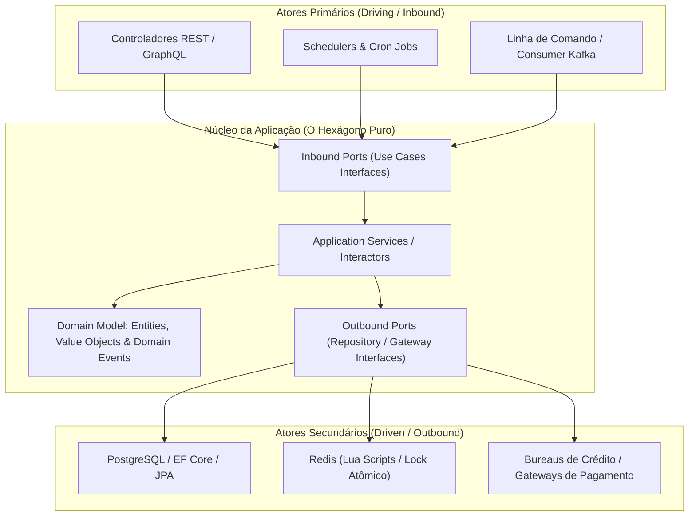

# 🏛️ Modelo Mental: Arquitetura Hexagonal (Ports & Adapters) & DDD

> **Guia de Referência Rápida para Backend Crítico (Java 21 / .NET 8 / TypeScript)**

---

## 1. Princípio Fundamental: A Regra de Dependência

> **O Domínio NUNCA conhece a infraestrutura externa, o framework ou o banco de dados.**  
> Todas as dependências apontam **para dentro**, em direção às regras de negócio puras.

---

## 2. Diferença Entre Camadas

| Camada | O que contém | O que pode importar | O que NUNCA deve conter |
| :--- | :--- | :--- | :--- |
| **Domain** | Entidades, Value Objects, Domain Exceptions, Eventos | **NADA** externo (apenas tipos puros da linguagem) | Anotações JPA/EF, `HttpServletRequest`, imports de SQL |
| **Application** | Casos de Uso (Use Cases), DTOs de entrada/saída, Portas (Interfaces) | Domain | Drivers de banco, frameworks HTTP (Spring/ASP.NET) |
| **Infrastructure** | Implementação de Repositórios, Adaptadores HTTP, Controllers, Redis Lua | Application, Domain, Frameworks externos | Regras de negócio arbitrárias sem passar pelo domínio |

---

## 3. Na Prática: Implementação nos Projetos

* **[fraud-detection-api](https://github.com/FelipeGardenghiDev/fraud-detection-api)**: Java 21, Spring Boot 3, Hexagonal puro, Redis Lua atômico, Virtual Threads.
* **[order-processing-api](https://github.com/FelipeGardenghiDev/order-processing-api)**: C# 12, .NET 8, Clean Architecture, CQRS (EF Core + Dapper), Channels.
