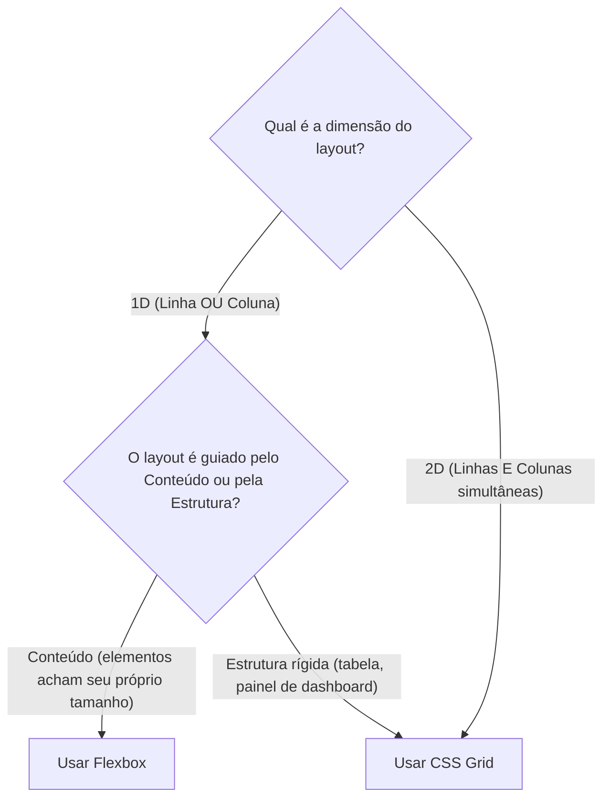

# 📐 Modelo Mental: Árvore de Decisão de Layout CSS (Flexbox vs Grid)

> **Guia de Decisão Rápida para Engenharia de Interface & Design Systems**

---

## 1. O Dilema: Flexbox 1D vs. CSS Grid 2D

Muitos desenvolvedores forçam Flexbox para criar grids complexos usando múltiplos `flex-wrap`, porcentagens e margens negativas, ou usam Grid para alinhar um ícone com texto.

---

## 2. Guia de Escolha Rápida

| Cenário de Interface | Escolha Recomendada | Por quê? |
| :--- | :---: | :--- |
| **Alinhar ícone + texto / barra de navegação** | `Flexbox` | 1D linear, alinhamento vertical simples via `items-center` e `gap-2`. |
| **Distribuição de botões / tags com quebra** | `Flexbox (flex-wrap)` | Elementos com tamanhos intrínsecos variáveis fluem naturalmente. |
| **Grid de cards com colunas iguais responsivas** | `CSS Grid` | `grid-template-columns: repeat(auto-fit, minmax(280px, 1fr))` elimina media queries. |
| **Layout de página completo (Header, Sidebar, Main, Footer)** | `CSS Grid` | Grid 2D explícito com `grid-template-areas` ou colunas/linhas fixas e fluidas. |
| **Mesa de controle virtual / StreamDeck** | `CSS Grid` | `grid-template-columns: repeat(N, 1fr)` garante pads perfeitamente alinhados em proporção 1:1. |
