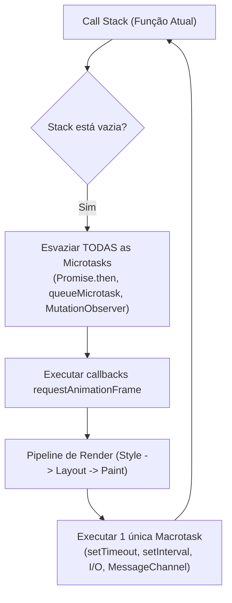

# ⚡ Modelo Mental: Event Loop, Microtasks & Concorrência no Navegador

> **Guia de Referência Rápida para Engenharia Web & DSP de Áudio**

---

## 1. A Fila de Execução (Call Stack, Microtasks & Macrotasks)

O JavaScript no navegador roda sobre uma única thread de execução principal (*Main Thread*), responsável simultaneamente por:
1. Executar seu código JS;
2. Processar eventos de UI (cliques, scroll);
3. Calcular estilos (Recalculate Style) e layout (Reflow / Layout);
4. Pintar pixels na tela (Repaint / Composite) a ~60 ou 120 FPS.

---

## 2. Tabela de Prioridades de Execução

| Estrutura | Exemplos | Quando é Drenada? | Impacto se Bloqueada |
| :--- | :--- | :--- | :--- |
| **Call Stack** | Execução síncrona `for`, chamadas de função | Imediatamente (LIFO) | Trava o navegador completamente (jank / crash) |
| **Microtasks** | `Promise.resolve().then()`, `queueMicrotask()` | **Imediatamente** após a stack esvaziar, até zerar | Loop de microtasks trava o render (UI congela) |
| **Animation Frames** | `requestAnimationFrame(callback)` | Antes do próximo ciclo de vsync/render (~16.6ms) | Queda de FPS em animações e compositing |
| **Macrotasks** | `setTimeout(fn, 0)`, `postMessage`, DOM events | **Uma por turno** do loop, após esvaziar microtasks | Atraso perceptível em cliques e timers |

---

## 3. Onde o Áudio e WebCodecs entram? (Isolamento de Threads)

Em aplicações sênior (como [GardenCut](https://github.com/FelipeGardenghiDev/garden-cut) e [Garden SFX Lab](https://github.com/FelipeGardenghiDev/garden-sfx-lab)):
* O **`AudioContext` / DSP** NÃO roda na main thread; roda no **Audio Render Thread** do sistema operacional, com prioridade de tempo real e buffer fixo (128 samples a 44.1kHz = ~2.9ms).
* Cálculos pesados (decodificação de vídeo, transformadas FFT, compressão) NUNCA devem rodar na main thread nem em microtasks; devem ser isolados em **Web Workers** ou **AudioWorklets**, comunicando-se via `ArrayBuffer` transferíveis (*Zero-Copy Transferable Objects*).
